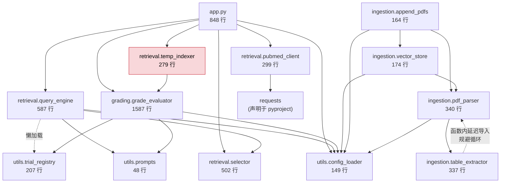
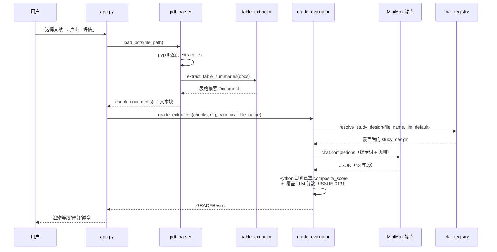
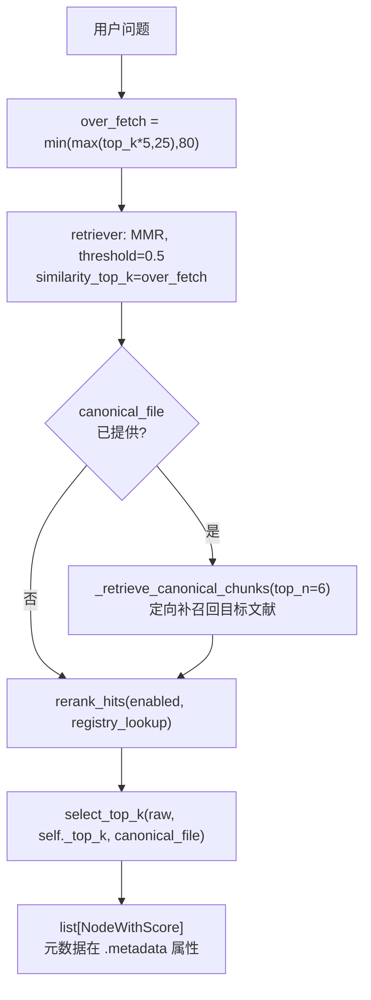
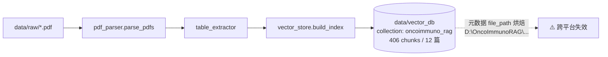
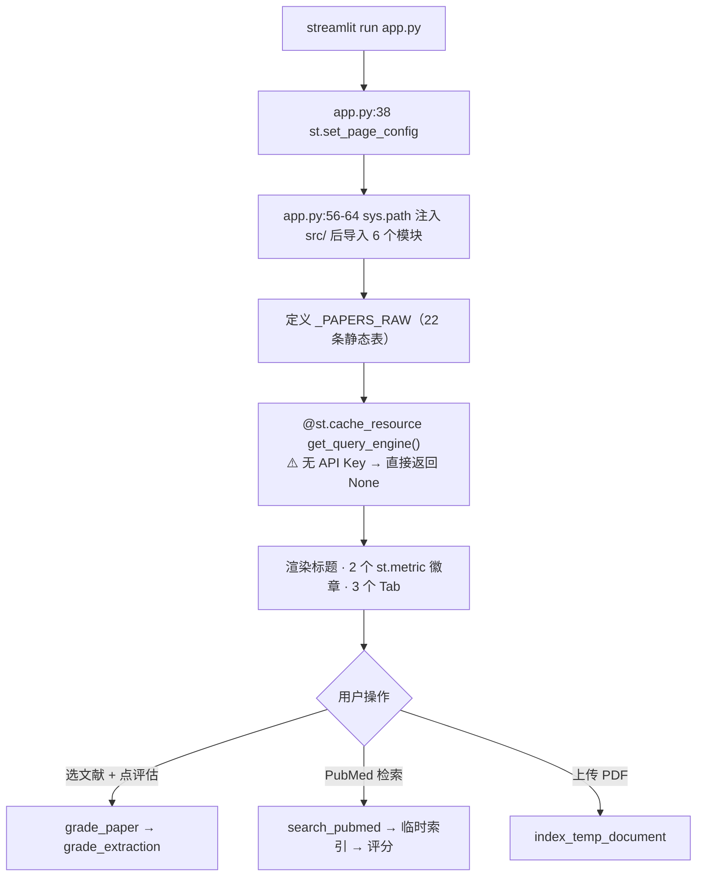

# ARCHITECTURE.md — OncoImmunoRAG

> 本文档描述**当前代码的真实状态**，不是目标架构，也不描述尚不存在的能力。
> 每条陈述都可对照 `git ls-files` 中的源码验证。已知缺陷见 `CURRENT_ISSUES.md`。

---

## 1. 系统形态

单体 Streamlit 应用 + 4 个纯 Python 包。**无 HTTP API、无数据库服务、无前端构建、无容器化**。

```
┌──────────────────────────────────────────────┐
│  浏览器 http://localhost:8501                 │
└──────────────────┬───────────────────────────┘
                   │ Streamlit 1.66
┌──────────────────▼───────────────────────────┐
│  app.py (848 行)                              │
│  UI 渲染 · 业务编排 · 静态文献表 · 会话缓存    │
└──────────────────┬───────────────────────────┘
                   │  模块级 from X import Y
   ┌───────────────┼───────────────┬──────────────┐
   ▼               ▼               ▼              ▼
 grading/      retrieval/      ingestion/     utils/
               query_engine    pdf_parser    config_loader
               selector        table_extractor  prompts
               temp_indexer    vector_store  trial_registry
               pubmed_client   append_pdfs
                   │
                   └──► grading.grade_extractor  ⚠️ 分层倒置
                              │
                              ▼
              ┌───────────────────────────────┐
              │ utils.config_loader           │
              │ （配置读取 + 数据目录定位）    │
              └───────────────────────────────┘
                   │
                   ▼
        config.yaml / 环境变量 / data/vector_db
                   │
                   ▼
        OpenAI 兼容端点 (MiniMax) · ChromaDB · NCBI E-utilities
```

## 2. 模块依赖关系（Mermaid）



**⚠️ `src/evaluation/` 是空壳包**（仅 `__init__.py` 中的 `__all__ = []`，无任何代码）。README 宣称的 "Evaluation harness" 不存在，故图中不绘制。

### 已知结构问题（记录，未修复）

| 问题 | 位置 |
|---|---|
| 分层倒置：检索层依赖评分层 | `retrieval/temp_indexer.py` → `grading/grade_evaluator.py` |
| 路径解析惯例重复 5 次 | `resolve_config_path().parent / "data" / X`，见 grade_evaluator:242、append_pdfs:90、pdf_parser:160、vector_store:42、query_engine:102 |
| 第 6 种写法，绕过 config_loader | `table_extractor.py:317,321` 用 `Path(__file__).resolve().parents[2]` |
| 陈旧源码副本 | `src_00/`（缺 2 模块，selector 少 225 行），已 gitignore |

---

## 3. 模块职责

| 模块 | 唯一职责 | 不负责 |
|---|---|---|
| `app.py` | 渲染 UI、编排调用、维护会话状态 | 不做检索算法、不做评分规则 |
| `utils/config_loader.py` | 读取 `config.yaml` + 环境变量，返回 `AppConfig`；定位 `data/` 目录 | 不做业务判断 |
| `utils/prompts.py` | 提供提示词文本片段 | 不发请求 |
| `utils/trial_registry.py` | 手工维护的研究设计覆盖表，**在评分时覆盖 LLM 输出** | 不发请求 |
| `ingestion/pdf_parser.py` | 加载 PDF、切块、附加表格摘要 | 不写数据库 |
| `ingestion/table_extractor.py` | 从 chunk 中抽取表格并生成摘要 | 不切块 |
| `ingestion/vector_store.py` | 构建/写入 ChromaDB 索引 | 不解析 PDF |
| `ingestion/append_pdfs.py` | 增量入库编排 | 不做检索 |
| `retrieval/query_engine.py` | 检索编排：MMR 超采样 → canonical 补召回 → rerank → select_top_k | 不发 LLM 请求（**其 `query()` 因缩进错误不可用**） |
| `retrieval/selector.py` | 证据等级 rerank + top_k 选取 | 不做嵌入、不连库 |
| `retrieval/temp_indexer.py` | 会话级临时 collection，支持上传 PDF 即时检索 | 不做评分规则（但会调用 grade_extraction） |
| `retrieval/pubmed_client.py` | NCBI E-utilities 检索与详情拉取 | 不做评分 |
| `grading/grade_evaluator.py` | 调用 LLM 产出 `GRADEResult` 并按 Python 规则重算综合分 | 不检索 |

---

## 4. 数据流

### 4.1 已实测跑通的主链路



**实测耗时**：UI 端到端 10.3s；直接调用 `grade_extraction()` 15.2s。

### 4.2 检索链路



**⚠️ 关键约束（实测）**：
- `top_k` **不是 `retrieve()` 的参数**，是构造时固定的 `self._top_k`（默认 **5**）。传入 `top_k=` 抛 `TypeError`。
- 返回值是 **llama-index 原生 `NodeWithScore`**，元数据通过 `.metadata` 属性访问，**不支持 `.get()` 字典访问**。
- ⚠️ 模块内存在同名自定义类 `_NodeWithScore`（`query()` 因缩进错误被埋在其中），**与返回值不是同一个类**。

### 4.3 入库链路（离线脚本，不在 Web 运行时执行）



---

## 5. 关键数据结构

### `GRADEResult`（pydantic，`grade_evaluator.py`）

13 字段，**全部必填，除最后两个**：

| 字段 | 类型 |
|---|---|
| `risk_of_bias` / `inconsistency` / `indirectness` / `imprecision` / `publication_bias` | `Literal['高','中','低']` |
| `confounding_by_subsequent_therapy` | `Literal['是','否','未报告']` |
| `study_design` | `Literal['RCT','观察性','系统评价','Meta分析','单臂试验']` |
| `sample_size` | `int` |
| `effect_size` | `str` |
| `overall_grade` | `Literal['高','中','低','极低']` |
| `grade_reasoning` | `str` |
| `composite_score` | `float`（可选） |
| `score_breakdown` | `str`（可选） |

⚠️ 5 个偏倚维度是**裸字符串**，不是嵌套对象。`scripts/` 下 7 个绘图脚本消费这些 JSON。

⚠️ **`study_design` 的受控词表是 `单臂试验`**，而 `app.py` 的 `design_gold` 用 `单臂` —— 两套词表，同一概念不同字面量。

### 双真相源（⚠️ 已知漂移风险）

| 位置 | 规模 | 是否参与评分 |
|---|---|---|
| `app.py:70-93` `_PAPERS_RAW` | 22 条 | ❌ 仅显示 |
| `utils/trial_registry.py:69` `TRIAL_REGISTRY` | 6 条 | ✅ **覆盖 LLM 输出** |

`design_gold` 全仓仅 2 处引用，均在 `app.py`（赋值 + 第 372 行显示），**从不与 LLM 输出比对** —— 界面上的「金标准设计」是装饰性的。

### 其他数据结构

均为 `dataclass`，字段见 `docs/interfaces.md`：`QueryResult`、`TempIndexResult`、`ExtractedTable`、`PubMedHit`、`PubMedDetail`、`TrialInfo`、`AppConfig`。

---

## 6. 外部依赖

| 类型 | 依赖 | 缺失后果 |
|---|---|---|
| 嵌入模型 | `BAAI/bge-large-en-v1.5`（1.3 GB，HF 托管） | 检索完全不可用；首次需联网 |
| LLM 端点 | OpenAI 兼容 API（`config.yaml` 的 `llm_base_url`） | 评分不可用 |
| 凭据 | 环境变量 `OPENAI_API_KEY` | `get_query_engine()` 返回 `None`，主链路静默失效 |
| 向量库 | 本地 ChromaDB `data/vector_db` | 检索不可用 |
| 论文 | 22 个 PDF（`data/raw` 12 + `verification` 5 + `holdout` 5） | Tab 1/2/3 不可用 |
| 外部服务 | NCBI E-utilities | 仅 Tab 2 的 PubMed 检索不可用 |

**未声明但被直接 import 的依赖**：`requests`（`pubmed_client.py`）—— 2026-10-23 已补入 `pyproject.toml`。

**缺失依赖**：`matplotlib`、`plotly`、`seaborn` —— `scripts/` 下 **8 个绘图脚本当前无法运行**。

---

## 7. 程序启动流程



`get_query_engine()` 是**惰性**的：仅在需要时构造，且**在无 API Key 时直接返回 `None`**，不构造 `QueryEngine`、不加载嵌入模型。